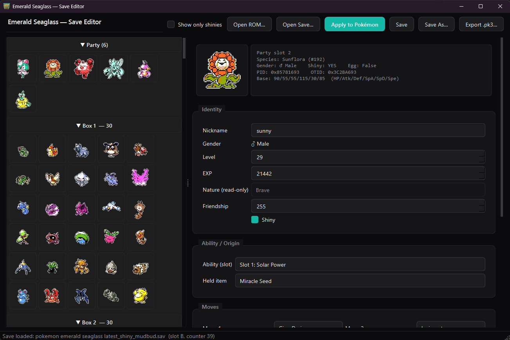
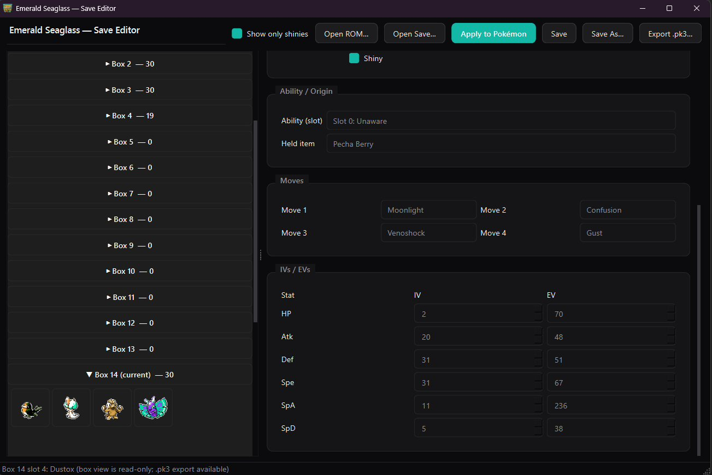

# seaglass save editor

a friendly desktop save editor for **pokemon emerald seaglass**. browse your
party and PC boxes, edit pokemon, and write back a clean, checksum-correct
save -- or export individual pokemon as `.pk3` files for use in PKHeX.

everything runs **locally**. your save file never leaves your computer and
nothing is uploaded anywhere.





## features

### viewing
- **party** browser -- every party pokemon shown as a sprite in a collapsible
  "party" section.
- **PC boxes** -- all 14 boxes shown as collapsible sprite grids (the current
  box is highlighted and auto-expanded). click any pokemon to see its details.
- **shiny indicator** -- shiny sprites have a star in their tooltip; a
  **"show only shinies"** toggle filters both party and boxes.
- **info panel** -- sprite, species, **gender**, shiny status, egg flag, PID,
  OTID and base stats.
- responsive layout -- sprite grids reflow to fit the window at any width.

### editing (party pokemon)
- nickname
- level and EXP
- friendship
- **ability** (all available ability slots)
- held item
- four moves
- IVs (0-31) and EVs (0-255) per stat
- **shiny** -- toggle on/off reliably:
  - on: sets the shiny flag.
  - off: clears the flag, and if the pokemon is *also* shiny by its PID,
    adjusts the hidden secret ID so it becomes genuinely non-shiny while
    keeping its visible trainer ID, nature, gender and everything else
    unchanged.

> **species and nature are read-only** by design. changing them would
> desynchronise internal PID-derived data (nature, gender, encryption). we
> leave them fixed to keep your save safe.

### saving and exporting
- **save** -- overwrite the currently-open save (with a confirmation prompt).
- **save as...** -- write to a new file (recommended; keeps your original safe).
- all writes recompute the affected sector checksums; the file stays valid.
- **export .pk3...** -- export the selected pokemon (party *or* box) as a
  100-byte Gen3 `.pk3` file for PKHeX. if the pokemon is shiny in-game, the export is made shiny by the standard Gen3 PID/OTID rule (only the hidden secret ID is adjusted), so it shows as shiny in both PKHeX and the game -- PID, visible trainer ID and nature are left untouched.

---

## how to run

### option 1 -- the ready-made executable (easiest, no install)
1. download `SeaglassEditor.exe` (from the releases page).
2. double-click it. that is it -- no python, no setup.

### option 2 -- run from source
1. install Python 3.11+.
2. run `setup.bat` once (creates a virtual environment and installs PySide6).
3. run `run_app.bat`.

---

## what you need
- your **seaglass save file** (`.sav`, typically from an emulator or flashcart).
- the **seaglass ROM** (`pokemon emerald seaglass.gba`) -- the editor reads
  species names, abilities, moves, items, stats and sprites from it. you must
  have the ROM; it is not bundled.

typical flow:
1. **open ROM...** -> choose your `.gba`.
2. **open save...** -> choose your `.sav`.
3. click a pokemon, make changes, **apply to pokemon**.
4. **save as...** (or **save**) to write the result.

---

## first-run warning (SmartScreen)

because the `.exe` is not code-signed, windows may show:

> "Windows protected your PC"

click **more info -> run anyway**. this is normal for unsigned independent
apps and does not indicate the file is unsafe. you can also build it yourself
from source (below) if you prefer.

---

## building the executable yourself

```
setup.bat          :: one-time: creates .venv and installs dependencies
build_exe.bat      :: builds dist\SeaglassEditor.exe (one-file, windowed)
```

the app icon is built from esg.png (a single 256x256 image); replace that file and rebuild so pp.ico is regenerated automatically.

releases are also built automatically on GitHub when a tag like `v0.1.0` is
pushed (see `.github/workflows/release.yml`).

---

## contributing

see [CONTRIBUTING.md](CONTRIBUTING.md) for setup, the code layout and the
pull-request process. contributions are welcome.

---

## notes and disclaimer

- this tool edits **your own save**. always **back up** your save before
  editing (the **save as...** button writes to a new file for exactly this
  reason).
- editing values that the game validates on load (e.g. impossible moves) may
  cause in-game quirkiness -- the editor does not enforce full legality.
- the PC box view is **read-only** in this version; box editing and `.pk3`
  import are planned.
- not affiliated with Nintendo, Game Freak, or the seaglass team. pokemon and
  related assets are trademarks of their respective owners.

---

## license

MIT -- see [LICENSE](LICENSE).

## credits
- reference behaviour cross-checked against PKHeX `.pk3` files.
- built with [PySide6](https://doc.qt.io/qtforpython/).